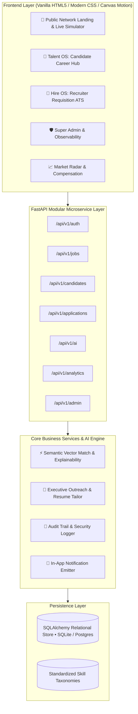

# 🌟 NexusTalent OS — Frontier Autonomous Talent & Career Intelligence Network

[](https://fastapi.tiangolo.com)
[](https://www.sqlalchemy.org)
[](https://sqlite.org)
[](https://www.python.org)
[](#)

> A production-grade, autonomous talent intelligence SaaS platform connecting elite engineering candidates with tier-1 technology organizations using multi-factor semantic embeddings, ATS resume tailoring, automated executive outreach generation, and full multi-tenant role-based access control.

---

## 🏛️ 1. Architecture Overview



---

## 👥 2. User Personas & Role-Based Portals

| Persona | Role Key | Capabilities & Workflows |
| :--- | :--- | :--- |
| **Candidate / Job Seeker** | `CANDIDATE` | Real-time AI job recommendations with score explainability, 1-Click Apply, live application status tracking, AI ATS resume tailoring, interactive interview preparation. |
| **Recruiter / Employer Admin** | `EMPLOYER_ADMIN` | Multi-tenant requisition management, AI-assisted job spec generation, candidate pipeline ranking, 1-click personalized outreach pitch generation, stage advancement. |
| **Super Admin** | `SUPER_ADMIN` | Global tenant management, system user controls, system health observability, real-time audit logs, skill taxonomy curation. |

---

## 🗄️ 3. Database Schema & Entities

The application uses SQLAlchemy with full relational foreign keys, indexes, and automated production seeding:

- **`organizations`**: Multi-tenant organizations (*Anthropic*, *Stripe*, *Vercel*, *Databricks*, *Supabase*).
- **`users`**: Platform accounts with password hashing and JWT authorization.
- **`candidate_profiles`**: Verified candidate technical skill arrays, experience years, salary expectations, GitHub/portfolio links.
- **`jobs`**: Requisitions with required/preferred skills, salary bands, equity, workplace type, and department.
- **`applications`**: Application lifecycle tracking (*Applied* $\rightarrow$ *AI Screened* $\rightarrow$ *Interview* $\rightarrow$ *Offered* $\rightarrow$ *Hired*).
- **`notifications`**: In-app real-time event notifications for candidates and recruiters.
- **`audit_logs`**: Tamper-evident mutation logs tracking user, action, module, entity ID, and IP address.
- **`skill_taxonomies`**: Normalized technology competencies with market salary multipliers.

---

## ⚡ 4. REST API Endpoint Reference

### Authentication & Access
- `POST /api/v1/auth/login` — User authentication returning JWT Bearer token
- `POST /api/v1/auth/register/candidate` — Candidate self-registration
- `POST /api/v1/auth/register/employer` — Tenant organization + recruiter onboarding
- `GET /api/v1/auth/me` — Current authenticated user profile

### Job Requisitions & Pipeline
- `GET /api/v1/jobs` — List active requisitions with optional organization filtering
- `POST /api/v1/jobs` — Create a new job requisition
- `GET /api/v1/candidates` — List verified talent pool candidates
- `POST /api/v1/candidates/parse-resume` — Instant OCR/text skill and experience extraction
- `GET /api/v1/applications` — Query candidate application records
- `POST /api/v1/applications/apply` — 1-Click apply to a requisition
- `PATCH /api/v1/applications/{id}/stage` — Move candidate across pipeline stages

### AI Automation & Multi-Agent Operations
- `GET /api/v1/recommendations/jobs-for-candidate/{id}` — Candidate vector recommendations & explainability
- `GET /api/v1/recommendations/candidates-for-job/{id}` — Recruiter candidate ranking & match scores
- `POST /api/v1/ai/autonomous-sourcing` — Autonomous talent sourcing agent with 3-touch sequence generation
- `POST /api/v1/ai/auto-screen-application/{id}` — Autonomous multi-factor candidate screening & rubric assessment
- `POST /api/v1/ai/mock-interview/grade-answer` — Interactive mock interview defense evaluator & model answer generator
- `POST /api/v1/ai/optimize-job-spec` — DEI bias scanner & high-converting job specification optimizer
- `POST /api/v1/ai/learning-roadmap` — Personalized 4-week career sprint & skill gap acceleration syllabus
- `GET /api/v1/candidates/{id}/dossier` — Executive candidate talent dossier & risk matrix generator
- `POST /api/v1/ai/generate-outreach` — Generate hyper-personalized executive outreach pitch
- `POST /api/v1/ai/tailor-resume` — ATS compatibility score & high-impact metric rewrites
- `POST /api/v1/ai/interview-prep` — Generate customized system design & gap probing questions
- `POST /api/v1/ai/generate-job-spec` — 1-prompt job requisition specification builder

### Observability & Admin
- `GET /api/v1/analytics/overview` — Aggregated market salary and skill inflation radar
- `GET /api/v1/admin/stats` — System health, total counts, and engine uptime
- `GET /api/v1/admin/audit-logs` — Global security audit trail

---

## 🛠️ 5. Running the Application Locally

### Prerequisites
- Python 3.10+
- `pip install -r backend/requirements.txt`

### Start the Backend Server
```bash
cd backend
python -m uvicorn app.main:app --host 0.0.0.0 --port 8000
```

### Access URLs
- **Web Platform**: [http://127.0.0.1:8000/](http://127.0.0.1:8000/)
- **Swagger Interactive API**: [http://127.0.0.1:8000/docs](http://127.0.0.1:8000/docs)
- **ReDoc Documentation**: [http://127.0.0.1:8000/redoc](http://127.0.0.1:8000/redoc)
- **Health Check**: [http://127.0.0.1:8000/health](http://127.0.0.1:8000/health)

---

## 🧪 6. Running the Automated Test Suite

Run the full end-to-end integration and API unit tests:
```bash
python -m pytest tests/test_api.py -v
```
*(All 18 tests validate authentication, RBAC, job creation, vector matching, autonomous sourcing, auto-screening, mock interview grading, DEI optimization, career roadmaps, and audit logs).*

---

## 🐳 7. Docker Deployment

```bash
docker-compose up --build -d
```
The application will launch on port `8000` with containerized persistence and auto-restart policies.
